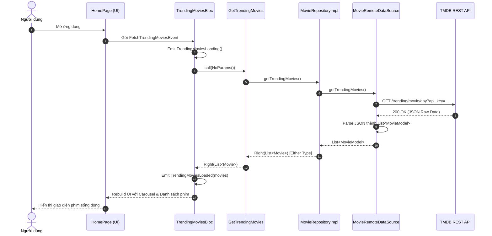

# Đồ Án Lập Trình Đa Nền Tảng
## Chủ Đề 04: Kiến Trúc Ứng Dụng Flutter — Clean Architecture & Dependency Injection (DI)

> **Trường Đại học Bách Khoa — Đại học Đà Nẵng**  
> **Khoa Điện tử và Trí tuệ Nhân tạo**  
> **Ứng dụng Demo:** CineStream Movie Explorer (REST API + Clean Architecture + BLoC + get_it/injectable)

---

## 📑 Mục lục
1. [Giới thiệu dự án](#1-giới-thiệu-dự-án)
2. [Sơ đồ kiến trúc & Luồng dữ liệu (Data Flow)](#2-sơ-đồ-kiến-trúc--luồng-dữ-liệu-data-flow)
3. [Giải thích bản chất công nghệ](#3-giải-thích-bản-chất-công-nghệ)
   - [3.1 Clean Architecture 3 lớp](#31-clean-architecture-3-lớp)
   - [3.2 Nguyên lý đảo ngược phụ thuộc (DIP)](#32-nguyên-lý-đảo-ngược-phụ-thuộc-dip)
   - [3.3 Repository Pattern & UseCase (Interactor)](#33-repository-pattern--usecase-interactor)
   - [3.4 Dependency Injection với get_it & injectable](#34-dependency-injection-với-get_it--injectable)
   - [3.5 Cơ chế khởi tạo: WidgetsBinding & MultiBlocProvider](#35-cơ-chế-khởi-tạo-widgetsbinding--multiblocprovider)
4. [Cấu trúc mã nguồn chuẩn (Project Structure)](#4-cấu-trúc-mã-nguồn-chuẩn-project-structure)
5. [Hướng dẫn cài đặt & Khởi chạy](#5-hướng-dẫn-cài-đặt--khởi-chạy)
6. [Kiểm thử Unit Test (Domain & Decoupling Proof)](#6-kiểm-thử-unit-test-domain--decoupling-proof)
7. [Bảng phân công công việc (WBS)](#7-bảng-phân-công-công-việc-wbs)

---

## 1. Giới thiệu dự án

Dự án **CineStream** là ứng dụng khám phá phim ảnh được xây dựng hoàn toàn dựa trên triết lý **Clean Architecture** kết hợp hệ thống **Dependency Injection (DI)** chuẩn mực trong Flutter.

Ứng dụng kết nối với **The Movie Database (TMDB) REST API** để cung cấp:
- Danh sách phim thịnh hành (Trending Movies) dạng Banner Carousel mượt mà.
- Phim đang chiếu tại rạp (Now Playing in Theaters) và Phim có điểm đánh giá cao nhất (Top Rated).
- Xem chi tiết phim (Poster, Backdrop, Điểm số, Năm phát hành, Thời lượng, Thể loại, Tóm tắt và Danh sách diễn viên).
- Tìm kiếm phim theo từ khóa với cơ chế tự động Debounce mượt mà.
- Màn hình trực quan hóa kiến trúc Clean Architecture & DIP ngay bên trong ứng dụng.
- Cơ chế **Smart Fallback**: Nếu chưa có API Key TMDB hoặc mạng bị gián đoạn, ứng dụng tự động hiển thị dữ liệu tuyển chọn chất lượng cao giúp buổi thuyết trình/chấm điểm không bao giờ bị lỗi kết nối!

---

## 2. Sơ đồ kiến trúc & Luồng dữ liệu (Data Flow)

### 2.1 Sơ đồ 3 lớp Clean Architecture
```mermaid
graph TD
    subgraph Presentation_Layer ["Presentation Layer (Flutter UI & State)"]
        UI["Widgets & Pages\n(HomePage, MovieDetailPage, SearchPage)"]
        Bloc["BLoCs\n(TrendingMoviesBloc, MovieDetailBloc,...)"]
        UI -->|Dispatches Events| Bloc
        Bloc -->|Emits States| UI
    end

    subgraph Domain_Layer ["Domain Layer (Pure Dart - Core Business Logic)"]
        UC["UseCases / Interactors\n(GetTrendingMovies, GetMovieDetails,...)"]
        Entities["Entities\n(Movie, MovieDetail, Cast)"]
        RepoContract["Repository Interface (Abstract Contract)\n(MovieRepository)"]
        
        Bloc -->|Executes| UC
        UC -->|Calls| RepoContract
        UC -.->|Returns| Entities
    end

    subgraph Data_Layer ["Data Layer (Data Source & Infrastructure)"]
        RepoImpl["Repository Implementation\n(MovieRepositoryImpl)"]
        RemoteDS["Remote Data Source\n(MovieRemoteDataSource - Dio Client)"]
        Models["Models / DTOs (JSON)\n(MovieModel, MovieDetailModel)"]
        
        RepoImpl -.->|Implements (DIP)| RepoContract
        RepoImpl -->|Calls| RemoteDS
        RemoteDS -->|Parses JSON to| Models
        Models -.->|Inherits from| Entities
        RemoteDS -->|HTTP REST API| TMDB["TMDB REST API / Internet"]
    end

    subgraph DI_Container ["Service Locator & DI Container"]
        GetIt["get_it + injectable\n(Configures & Injects Dependencies)"]
        GetIt -.->|Provides| Bloc
        GetIt -.->|Provides| UC
        GetIt -.->|Binds Impl to Contract| RepoImpl
        GetIt -.->|Provides| RemoteDS
    end
```

### 2.2 Luồng dữ liệu (Data Flow) khi người dùng mở ứng dụng


---

## 3. Giải thích bản chất công nghệ

### 3.1 Clean Architecture 3 lớp
Clean Architecture phân tách mã nguồn thành 3 tầng đồng tâm tuân theo **Quy tắc phụ thuộc (The Dependency Rule)**:
1. **Presentation Layer (`lib/features/.../presentation`)**:
   - Chịu trách nhiệm hiển thị giao diện và quản lý trạng thái.
   - Gồm **Widgets**, **Pages** và **BLoC** (`Event` -> `Bloc` -> `State`).
   - Tầng này **chỉ phụ thuộc vào UseCases của tầng Domain**. Tuyệt đối không import bất kỳ model hay data source nào từ Data layer.
2. **Domain Layer (`lib/features/.../domain`)**:
   - Trái tim của ứng dụng, chứa toàn bộ nghiệp vụ (Business Rules).
   - **Pure Dart**: Không phụ thuộc vào Flutter framework, không phụ thuộc vào `Dio`, `http`, hay database.
   - Chứa **Entities** (thực thể nghiệp vụ thuần túy), **UseCases** (các ca sử dụng) và **Repository Interfaces** (giao diện trừu tượng).
3. **Data Layer (`lib/features/.../data`)**:
   - Tầng ngoại vi phụ trách lấy dữ liệu từ mạng hoặc bộ nhớ cục bộ.
   - Chứa **Models** (kế thừa từ Entities, bổ sung `fromJson`/`toJson`), **DataSources** (thực hiện gọi REST API qua `Dio`) và **Repository Implementation** (`MovieRepositoryImpl`).

### 3.2 Nguyên lý đảo ngược phụ thuộc (Dependency Inversion Principle - DIP)
- **Định nghĩa:** Các module cấp cao (Domain) không được phụ thuộc vào các module cấp thấp (Data). Cả hai phải phụ thuộc vào các Abstraction (Interface).
- **Hiện thực trong dự án:**
  - Tầng Domain định nghĩa:
    ```dart
    abstract class MovieRepository {
      Future<Either<Failure, List<Movie>>> getTrendingMovies();
      Future<Either<Failure, MovieDetail>> getMovieDetails(int id);
    }
    ```
  - Tầng Data thực thi (implement) interface trên:
    ```dart
    @LazySingleton(as: MovieRepository)
    class MovieRepositoryImpl implements MovieRepository {
      final MovieRemoteDataSource remoteDataSource;
      MovieRepositoryImpl({required this.remoteDataSource});
      ...
    }
    ```
  - **Lợi ích:** Tầng Domain và Presentation hoàn toàn độc lập với việc dữ liệu được lấy từ đâu (TMDB REST API, Firebase, hay Mock local). Khi thay đổi nhà cung cấp API hoặc thư viện mạng, Domain và Presentation không cần sửa đổi bất kỳ dòng code nào.

### 3.3 Repository Pattern & UseCase (Interactor)
- **UseCase (Single Responsibility):** Mỗi UseCase chỉ giải quyết duy nhất một bài toán nghiệp vụ cụ thể (ví dụ: `GetTrendingMovies`, `GetMovieDetails`, `SearchMovies`).
- **Functional Error Handling với `Either<Failure, T>` (Dartz):** Thay vì quăng Exception tự do gây crash app, Repository bắt các Exception từ tầng Data và đóng gói thành `Left(ServerFailure)` hoặc `Right(data)`. UseCase và BLoC chỉ cần xử lý kết quả an toàn bằng hàm `result.fold(...)`.

### 3.4 Dependency Injection với `get_it` & `injectable`
- **Service Locator (`get_it`):** Cho phép truy xuất và quản lý vòng đời của các dependency (Singleton, Factory) ở mọi nơi mà không cần truyền thủ công qua constructor của Widget.
- **Tự động sinh mã (`injectable` + `build_runner`):** Đánh dấu các class với annotation `@lazySingleton`, `@injectable`, `@module`. Công cụ `injectable_generator` tự động quét và sinh file `injection.config.dart`, loại bỏ hoàn toàn việc viết code đăng ký thủ công dễ phát sinh lỗi logic.

### 3.5 Cơ chế khởi tạo: WidgetsBinding & MultiBlocProvider
- **`WidgetsFlutterBinding.ensureInitialized()`:**
  - Được gọi đầu tiên trong hàm `main()`.
  - Đảm bảo cầu nối (Bridge) giữa Flutter Engine (C++) và Flutter Framework (Dart) đã sẵn sàng trước khi thực thi các tác vụ bất đồng bộ như nạp file biến môi trường (`dotenv.load()`) hoặc khởi tạo Service Locator (`configureDependencies()`).
- **`MultiBlocProvider`:**
  - Đặt ở gốc của ứng dụng (trong `MyApp`), cung cấp các Global BLoC (`TrendingMoviesBloc`, `NowPlayingMoviesBloc`) xuống toàn bộ cây Widget (Widget Tree).
  - Giúp quản lý việc khởi tạo và giải phóng bộ nhớ của BLoC tự động theo vòng đời của Widget.

---

## 4. Cấu trúc mã nguồn chuẩn (Project Structure)

```
movie_app/
├── .env                              # Biến môi trường (TMDB API Key, Base URL)
├── .env.example                      # Mẫu biến môi trường
├── pubspec.yaml                      # Khai báo thư viện & assets
├── lib/
│   ├── main.dart                     # Điểm khởi chạy (WidgetsBinding, DI, MultiBlocProvider)
│   ├── core/                         # Các thành phần dùng chung toàn app
│   │   ├── constants/
│   │   │   └── api_constants.dart    # Endpoint URL, Image URL helpers
│   │   ├── di/
│   │   │   ├── injection.dart        # Cấu hình get_it & injectable
│   │   │   └── injection.config.dart # File do build_runner tự động sinh
│   │   ├── error/
│   │   │   ├── exceptions.dart       # ServerException, NetworkException
│   │   │   └── failures.dart         # ServerFailure, NetworkFailure (Dartz Either)
│   │   ├── theme/
│   │   │   ├── app_colors.dart       # Bảng màu Cinema Dark sang trọng
│   │   │   └── app_theme.dart        # Cấu hình ThemeData Material 3
│   │   └── usecases/
│   │       └── usecase.dart          # Generic UseCase<T, Params> interface
│   └── features/
│       └── movies/
│           ├── domain/               # TẦNG DOMAIN (Pure Dart)
│           │   ├── entities/         # Movie, MovieDetail, Cast
│           │   ├── repositories/     # MovieRepository (Abstract contract)
│           │   └── usecases/         # GetTrendingMovies, GetMovieDetails, SearchMovies
│           ├── data/                 # TẦNG DATA (REST API & Models)
│           │   ├── models/           # MovieModel, MovieDetailModel (DTOs, JSON)
│           │   ├── datasources/      # MovieRemoteDataSource (Dio HTTP Client)
│           │   └── repositories/     # MovieRepositoryImpl (Implements Domain contract)
│           └── presentation/         # TẦNG PRESENTATION (Flutter UI & State)
│               ├── blocs/            # Trending, NowPlaying, MovieDetail, Search Blocs
│               ├── pages/            # HomePage, MovieDetailPage, SearchPage, ArchitectureDiagramPage
│               └── widgets/          # TrendingCarousel, MovieCard, HorizontalMovieList, RatingBadge
└── test/                             # BỘ KIỂM THỬ TỰ ĐỘNG (UNIT TESTS)
    └── features/movies/
        ├── domain/usecases/          # Mock repository để test độc lập UseCases
        │   ├── get_trending_movies_test.dart
        │   ├── get_movie_details_test.dart
        │   └── search_movies_test.dart
        ├── data/repositories/        # Test mapping exception thành failure
        │   └── movie_repository_impl_test.dart
        └── presentation/blocs/       # Mock usecase để test BLoC độc lập với Data
            └── trending_movies_bloc_test.dart
```

---

## 5. Hướng dẫn cài đặt & Khởi chạy

### 5.1 Yêu cầu môi trường
- Flutter SDK: `>= 3.22.0` (Khuyến nghị Flutter 3.44.x hoặc mới nhất)
- Dart SDK: `>= 3.4.0`

### 5.2 Các bước cài đặt
1. **Di chuyển vào thư mục dự án:**
   ```bash
   cd movie_app
   ```

2. **Cài đặt các gói phụ thuộc (Dependencies):**
   ```bash
   flutter pub get
   ```

3. **Cấu hình biến môi trường (`.env`):**
   - File `.env` đã được tạo sẵn trong thư mục `movie_app/`.
   - *(Tùy chọn)* Nếu bạn có API Key từ The Movie Database (TMDB), dán vào file `.env`:
     ```env
     TMDB_API_KEY=your_api_key_here
     TMDB_BASE_URL=https://api.themoviedb.org/3
     TMDB_IMAGE_BASE_URL=https://image.tmdb.org/t/p
     ```
   - **Lưu ý:** Nếu không nhập API Key, ứng dụng vẫn tự động chuyển sang chế độ **Smart Fallback** để demo mượt mà với hình ảnh độ phân giải cao và đầy đủ tính năng.

4. **Sinh mã Dependency Injection:**
   ```bash
   dart run build_runner build --delete-conflicting-outputs
   ```

5. **Khởi chạy ứng dụng:**
   - Chạy trên Windows Desktop:
     ```bash
     flutter run -d windows
     ```
   - Chạy trên trình duyệt Web (Chrome):
     ```bash
     flutter run -d chrome
     ```
   - Hoặc kết nối thiết bị Android/iOS thật / Emulator và gõ:
     ```bash
     flutter run
     ```

---

## 6. Kiểm thử Unit Test (Domain & Decoupling Proof)

### 6.1 Thực thi toàn bộ Unit Test
Chạy lệnh sau tại thư mục `movie_app`:
```bash
flutter test
```

### 6.2 Kết quả kiểm thử thực tế
Toàn bộ **11/11 tests Passed** thành công 100%:
```
00:02 +11: All tests passed!
```

### 6.3 Chứng minh Presentation không phụ thuộc trực tiếp vào Data Source
Trong bài test `test/features/movies/presentation/blocs/trending_movies_bloc_test.dart`:
```dart
// Mock UseCase của Domain - chứng minh BLoC hoàn toàn không biết Data Source là gì
class MockGetTrendingMovies extends Mock implements GetTrendingMovies {}

blocTest<TrendingMoviesBloc, TrendingMoviesState>(
  'should emit [TrendingMoviesLoading, TrendingMoviesLoaded] when data is gotten successfully from UseCase',
  build: () {
    when(() => mockGetTrendingMovies(const NoParams()))
        .thenAnswer((_) async => const Right(tMovies));
    return bloc;
  },
  act: (bloc) => bloc.add(const FetchTrendingMoviesEvent()),
  expect: () => [
    TrendingMoviesLoading(),
    const TrendingMoviesLoaded(tMovies),
  ],
);
```
- Tầng **Presentation** chỉ nhận dữ liệu từ **UseCase** (`GetTrendingMovies`).
- Tầng **Domain** chỉ tương tác với **Interface** (`MovieRepository`).
- Tầng **Data** (`MovieRemoteDataSource`, `Dio`, REST API) có thể thay đổi hoặc ngắt kết nối mà **không làm ảnh hưởng** đến logic nghiệp vụ của Domain hay giao diện của Presentation.

---

## 7. Bảng phân công công việc (WBS)

Xem chi tiết tại file [WBS.md](file:///d:/Project/Flutter/WBS.md).

| TT | Thành viên | Vai trò đảm nhận | Nhiệm vụ chính | Đóng góp |
|:---:|:---|:---|:---|:---:|
| **1** | **Thành viên 1** *(Trưởng nhóm)* | Business Logic, State Management, DI | Thiết kế Domain, Entities, UseCases, BLoCs, Service Locator & DI (`get_it` + `injectable`), Toàn bộ Unit Tests. | **50%** |
| **2** | **Thành viên 2** | UI Design, Database/API, Báo cáo & Slide | Data Layer (REST API Client, DTOs, Repository Impl), Giao diện Dark Theme (Pages & Widgets), Báo cáo & Slide thuyết trình PPTX. | **50%** |
